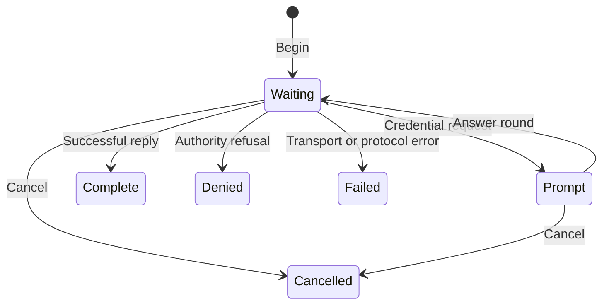

The authentication client library, `libauth.so.1`, connects applications to
the Peios authentication authority. It carries credential conversations,
identity queries, self-account changes, and requests to end logon sessions.
The authority checks the connected caller and decides what it can do.

## Authenticate and Logon

Both operations use the same credential conversation. Authenticate returns
an established identity and the requested groups and claims. It creates no
OS token, session, home directory or user registry. Logon additionally checks
local logon policy and returns a token and session for the caller to install.
An Authenticate result cannot be exchanged for a token later.

Use Authenticate for a service that needs to check identity before applying
its own access policy. Authd does not need to understand a Wi-Fi network or
the meaning of a department claim. The service interprets the identity data.

The shared authentication request supplies the identifier, supported
credential types, an optional required type and any method binding. A
password-based consumer sets Password as required: advertising support alone
also permits an account whose source intentionally requires no credential.

Authenticate separately requests full source group membership and selects
None, Named or AllPermitted claim disclosure. AuthenticationSecurity checks
group and named-claim permissions before credential collection. Forbidden named
disclosure fails the request. An authorized named claim absent from the source
is listed explicitly; unrequested groups differ from an empty membership set.
Group results exclude locally synthesized token groups.

Claim names use KACS's per-character Unicode lowercase mapping, without
normalization or full case folding. Équipe and équipe name the same claim;
ß and ss do not. This applies to lookup, duplicate detection, known absence
and claim-specific permission GUIDs. Results retain the source's spelling;
claim-value matching is unchanged. A Named absence can therefore supply
partial KACS claim knowledge using the same name rule. Other sources must
establish matching semantics before their absence assertions are adapted.

This replaces the unpublished ASCII-only development rule. Before upgrading,
regenerate affected non-ASCII claim permission GUIDs using auth-policy's
claim_guid helper while preserving grants and denies. ASCII identifiers stay
unchanged. Resolve source records containing newly equivalent duplicate names;
authd refuses their assertions rather than choosing one. Rebuild named-disclosure
clients with the matching auth-core revision. Public framing and the C ABI
version check move to 4 so an older authority/library cannot supply an unsafe
ASCII-only absence result. Message bodies and C struct layouts are unchanged.

AllPermitted returns readable claims and a coverage marker. Complete means
the result is the whole claim set and omitted names are absent. Filtered means
some names may be restricted; omitted names remain unknown. Authd determines
coverage from policy rather than the presence of hidden claims, and never
reports restricted names or counts. A consumer must deny a policy decision
that needs unknown information. Conditions using returned values or complete
group membership can still be evaluated normally.

In C, begin with peios_auth_authenticate_begin, read AuthenticationView and
the existing identity getters at record index zero, and enumerate absent
claims with peios_auth_authentication_absent_claim. The operation owns the
result until destroyed. The Rust Client::authenticate wrapper returns an owned
Authenticated result through Operation::authenticated. No token accessor
succeeds for this operation. AuthenticationView.claim_coverage preserves this
knowledge through the C ABI; the owned Rust result exposes ClaimCoverage.
The coordinated unpublished C ABI and public PGSS framing versions are 4.
Rebuild clients with the matching library; the source protocol remains version 2.

## Credential collection

A logon begins with a proposed identity, logon type, and the credential types
the application can collect. The authority can request several rounds of
answers. Each round contains messages to display and prompts to answer. The
application controls its interface; the library does not read a terminal or
create a window.

Prompt labels are display text. Credential types and parameters determine how
to collect an answer. Applications advertise supported types and reject
requests they cannot handle. Passwords must not be echoed. Secure Shell
(SSH) credentials retain the binding to the authorized originator's live
transport.

The supported credential list describes what the client can collect. It does
not force the source to request a password. An empty list permits only a
conversation that needs no collection; it does not bypass account policy.

The authority reads the connected caller's token from the kernel. A proposed
logon type is checked against that caller's originator policy. Fields such as
the remote host remain claims supplied by the client, not independently
verified identity.

Credential verification establishes identity. Token derivation combines that
identity with this machine's grants. A source does not send a finished token
or choose the machine's privilege set and integrity level.

An unknown account and an incorrect credential share the authentication
failure response. The local source performs a decoy password verification for
unknown accounts instead of taking a cheap early-return path. This does not
make account existence secret: the separate identity interface can report
that a principal does not exist. For diagnosis, compare the authority and
source [authentication
events](~peios/authentication/audit-events), without recording
credential values.

## Tokens and sessions

Successful logon returns a token descriptor, session ID, and profile. The
profile supplies a home directory, shell, and display name; these fields are
session-start preferences, not proof of identity.

The operation owns the token until the caller takes it. Taking the token
transfers responsibility for closing its descriptor. Installing it and
starting a process are separate, explicit actions through the Peios software
development kit (SDK).
Destroying an operation closes any token it still owns.

The shared protocol transport accepts at most one descriptor per message.
It rejects extra descriptors and truncated ancillary data, closing received
descriptors if it cannot accept the complete message.

A service manager requests a service token through a distinct attestation
operation. Self-service credential changes identify the caller from the
connection; they do not accept a target username.

## Completion and uncertainty

An authority refusal differs from a lost connection. If a connection fails
after a change was submitted, the change could have taken effect. The error
reports this as `outcome_unknown`. Cancellation stops communication but cannot
roll back a submitted change. The library never retries a mutation on the
application's behalf.

Ending a session can terminate the program requesting the action. For that
case, authd replies before termination and reports prospective process counts.
A permission query is advisory: the later action is checked again.

## Identity results

Identity queries retain the difference between a missing identity, an
unavailable source, and a refused request. A field can have an empty value or
be withheld for a stated reason. These are different results.

Enumeration returns an opaque continuation cursor and a list of sources that
did not contribute. A page with no records can still have a cursor. Continue
until the cursor is empty, and preserve the incomplete-source information when
presenting the result.

Read [Using the Authentication
Client](~peios/authentication-client/using-the-library) for the operation loop
and resource ownership.
