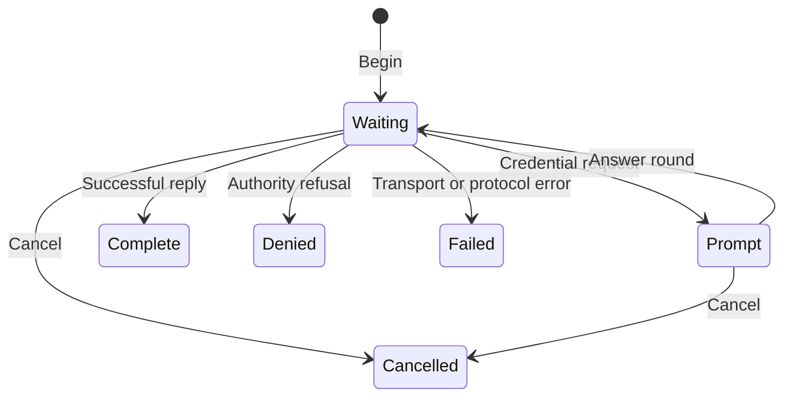

The authentication client library, `libauth.so.1`, connects applications to
the Peios authentication authority. It carries credential conversations,
identity queries, self-account changes, and requests to end logon sessions.
The authority checks the connected caller and decides what it can do.

## Credential collection

A logon begins with a proposed identity, logon type, and the credential types
the application can collect. The authority can request several rounds of
answers. Each round contains messages to display and prompts to answer. The
application controls its interface; the library does not read a terminal or
create a window.

Prompt labels are display text. Credential types and parameters determine how
to collect an answer. Applications advertise supported types and reject
requests they cannot handle. Passwords must not be echoed. Secure Shell
(SSH) credentials retain the binding to the authorized originator's live
transport.

## Tokens and sessions

Successful logon returns a token descriptor, session ID, and profile. The
profile supplies a home directory, shell, and display name; these fields are
session-start preferences, not proof of identity.

The operation owns the token until the caller takes it. Taking the token
transfers responsibility for closing its descriptor. Installing it and
starting a process are separate, explicit actions through the Peios software
development kit (SDK).
Destroying an operation closes any token it still owns.

The shared protocol transport accepts at most one descriptor per message.
It rejects extra descriptors and truncated ancillary data, closing received
descriptors if it cannot accept the complete message.

A service manager requests a service token through a distinct attestation
operation. Self-service credential changes identify the caller from the
connection; they do not accept a target username.

## Completion and uncertainty

An authority refusal differs from a lost connection. If a connection fails
after a change was submitted, the change could have taken effect. The error
reports this as `outcome_unknown`. Cancellation stops communication but cannot
roll back a submitted change. The library never retries a mutation on the
application's behalf.

Ending a session can terminate the program requesting the action. For that
case, authd replies before termination and reports prospective process counts.
A permission query is advisory: the later action is checked again.

## Identity results

Identity queries retain the difference between a missing identity, an
unavailable source, and a refused request. A field can have an empty value or
be withheld for a stated reason. These are different results.

Enumeration returns an opaque continuation cursor and a list of sources that
did not contribute. A page with no records can still have a cursor. Continue
until the cursor is empty, and preserve the incomplete-source information when
presenting the result.

Read [Using the Authentication
Client](~peios/authentication-client/using-the-library) for the operation loop
and resource ownership.
